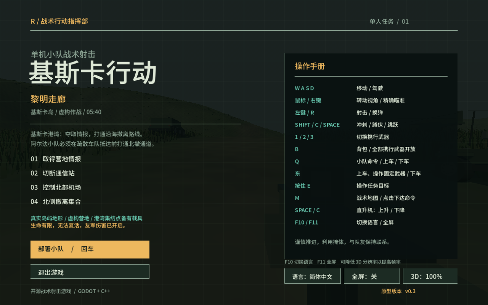

# Kiska Command / 基斯卡行动

A single-player tactical squad FPS prototype built with **Godot 4.5 + C++17**, set on real USGS-derived Kiska Island terrain. / 一款基于真实基斯卡岛地形的开源单机小队战术 FPS 原型。

**v0.7：你下达意图，队员完成步骤。** 轻点 Q 执行上下文任务，长按 Q 才打开详细命令。装载运输机时，队员负责找司机、分座、上车、接近、开舱、驶入、固定与关舱；卸载时倒车出舱、下车并警戒。



项目为原创灰盒原型，不包含《闪点行动》的代码、模型、音效或原版地图。没有多人模式，AI 导航、车辆和飞行仍是简化模拟。

## 下载游戏

[GitHub Releases 下载](https://github.com/benzeneringlq/kiska-command/releases)：提供 **Windows x86_64、Linux x86_64、macOS Universal** 三个游戏包。Mac 通用包同时原生支持 Intel 和 Apple Silicon（M1/M2 等），无需选择 CPU 版本。完整解压后启动，无需安装 Godot；不要选择仅含源码的 Source code 下载项。

Windows 打开 `KiskaCommand.exe`；Linux 运行 `./KiskaCommand.x86_64`；macOS 打开 `Kiska Command.app`。macOS 使用 ad-hoc 本地签名，暂未苹果公证，首次启动可能需要在“系统设置 → 隐私与安全性”选择“仍要打开”。Windows 也未配置付费签名证书。

## 从源码启动

依赖：Godot 4.5+、CMake 3.20+、Ninja、C++17 编译器、Python 3。

```sh
git clone https://github.com/benzeneringlq/kiska-command.git
cd kiska-command
./tools/bootstrap.sh
./tools/build.sh
./tools/run.sh
```

当前 Mac 已经构建，可直接双击 `Play.command`。`GODOT_BIN=/path/to/godot ./tools/run.sh` 可指定已有引擎。Godot 编辑器入口为 `game/project.godot`。

bootstrap 在 macOS 下载官方 Godot 4.5.2，并取得固定版本的 godot-cpp；Linux/Windows 请自行准备对应架构的 Godot。当前实际游戏验证平台为 Intel Mac / Radeon Pro 555，其他平台仍需各自验证。只编译本项目扩展，不重新编译引擎。

## 少步骤的指挥

| 目标 / 操作 | 小队自动执行 |
| --- | --- |
| 轻点 Q，指向地面 | 前往并警戒；合适的长距离移动可使用附近陆地载具 |
| 轻点 Q，指向敌人 | 协同攻击目标 |
| 轻点 Q，指向空载具 | 分配驾驶员与乘客，实际上车待命 |
| 轻点 Q，指向己方队员乘坐的车 | 停车、下车、集结 |
| 轻点 Q，指向运输机 | 选择附近待装载车辆并完成装载；无可用外部车辆且舱内有货物时执行卸载 |
| 长按 Q | 保留上车、下车、移动及跟随/守位等详细控制 |
| 跟随模式下玩家上/下车 | 队员自主跟随登车或离车；明确的守位/装载任务不会被覆盖 |

不必先打开 J、逐人选座或手动逐个完成装载步骤。任务进度与受阻原因持续显示；新命令可替换旧任务。玩家亲自驾驶时不会被 AI 抢走驾驶位；想让队员驾驶可用 F 选择乘客位。

参考 [Ghost Recon 开发说明](https://news.ubisoft.com/en-us/article/4SyaGiGbgskidYNiaxKGx4/ghost-recon-breakpoint-its-the-best-time-to-jump-back-in)、[Arma Reforger 指挥系统说明](https://reforger.armaplatform.com/news/dev-report-21) 和 [LimboAI 任务状态模式](https://github.com/limbonaut/limboai/blob/master/doc/source/behavior-trees/introduction.rst)。这是独立实现，没有引入这些游戏的资产或直接集成 LimboAI。设计与边界见 [command-design.md](docs/command-design.md)。

## 按键

| 功能 | 操作 |
| --- | --- |
| 移动 / 开火 / 瞄准 / 换弹 | WASD / 左键 / 右键 / R |
| 武器槽 / 全武器背包 | 1、2、3 / B |
| 智能命令 / 详细命令 | 轻点 Q / 长按 Q |
| 玩家上车选座 / 下车 / 换座 | E / E / F |
| 车外视角 / 精确选择载具 | V / J |
| 地图目的地 | M；点击下令，双指滚动或捏合缩放，右键拖动平移 |
| 地面驾驶 | WASD；Space 刹车 |
| 直升机 | WASD 水平移动与转向，Space 上升，C 下降 |
| 重型运输机 | W/S 油门，A/D 转向，Space 爬升，C 下降；需约 30 m/s 才有简化升力 |
| 手动舱门 / 固定 / 投放 / 拖缆 | G / L / O / T |
| 跳跃 / 蹲伏 / 冲刺 | Space / C / Shift |
| 暂停 / 中文英文 / 全屏 | Esc / F10 / F11 或 Alt+Enter |

手动 G/L 只能作用于当前运输机、实际所在货舱，或控制点 8 m 内准星指向的飞机；J 不是远程舱门遥控。O 仅允许本机飞行员操作，投放使用简化减速伞。

## 内容与性能范围

- 真实基斯卡岛：49.152 × 49.152 km 区域含海域；1025² 高程采样，48 m 输出间隔，无地形比例压缩。近景 8 m 网格不是 8 m 实测数据。
- 整岛粗远景、中距离网格与最多九块近景碰撞地形；苔原草丛、灌木和岩石分批加载。同步生成仍可能造成卡顿，未承诺最低帧率。
- 四阶段虚构港湾任务、28 栋可进入房屋、三名队友、30 名守军；整岛尚未铺满任务。
- 35 种携行武器与架设 M2；保留独立弹药，支持霰弹与火箭爆炸。模型按类别生成。
- 越野车、APC、坦克、卡车、直升机、重型运输机和固定机枪，共 12 个实体。悬挂、拖挂、载人货物固定、可走动车厢和货舱均为简化实现。
- 运输机最多装两个陆地载具。舱内下坦克会检查真实货舱地板及其他人物位置；飞行中也留在舱内。实际接地停稳并开舱后才能离机。
- 默认中文，可切英文；全屏和 100% / 75% / 50% 三维分辨率设置。设置目录保留早期内部名称，避免现有玩家设置丢失。

## 验证与贡献

```sh
./tools/test.sh
./tools/benchmark.sh
```

实际引擎套件覆盖战斗、四阶段任务、设置、驾驶、多人安全下车、飞行中舱内走动、装载投放、拖挂和智能任务。记录及未验证范围见 [verification.md](docs/verification.md)。普通提交的 GitHub Actions 验证独立 C++ 核心；发布流程编译 Release 扩展、导出完整游戏，在 Windows、Linux、Mac Apple Silicon 上分别运行导出游戏的 184 项集成检查，再把同一 Mac 通用压缩包下载到 Intel Mac 上原生运行相同检查。自动检查使用无显示器模式，不能替代各显卡的实际画面和性能验证。

## 自动发布

推送与 `game/project.godot` 版本一致的 `v*` 标签（例如 `v0.7.3`）会启动 [Desktop release](.github/workflows/release.yml)。四种运行环境全部成功后，自动发布三个游戏包及 SHA-256 校验文件。失败时不发布不完整的新版本；可在 Actions 页面重新运行。手动 Run workflow 可先构建下载 Actions 中的游戏包，选择版本标签运行时也会发布。

构建工具固定到 Godot 4.5.2，下载官方引擎与模板并校验 SHA-512；不重新编译引擎。Mac 使用官方 Universal 2 模板，C++ 扩展也编译成双架构。各包包含第三方许可与构建版本信息。

[贡献说明](CONTRIBUTING.md) · [素材与高程来源](ASSETS.md) · [MIT 许可证](LICENSE)

USGS 地形与 Noto Sans SC 字体保留各自许可，不改称本项目 MIT 资产。godot-cpp 固定到 `godot-4.5-stable` / `e83fd0904c13356ed1d4c3d09f8bb9132bdc6b77`，引擎、绑定、构建缓存和本地可执行文件不提交到仓库。
