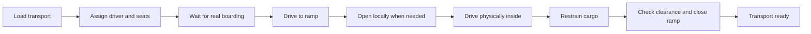

# Intent-based squad commands

Kiska Command v0.7 separates the player's request from the small actions needed to execute it. The implementation is original; the following public systems inform the design.

## References

- [Ubisoft: Ghost Recon Breakpoint developer interview](https://news.ubisoft.com/en-us/article/4SyaGiGbgskidYNiaxKGx4/ghost-recon-breakpoint-its-the-best-time-to-jump-back-in): teammates should cooperate efficiently without frequent player orders. Keep a small set of important intents such as regroup, move and engage.
- [Bohemia Interactive: Arma Reforger Dev Report #21, Commanding System](https://reforger.armaplatform.com/news/dev-report-21): group-level waypoint commands and extensible contextual/radial menus. We retain an optional detailed menu rather than requiring it for every action.
- [LimboAI behavior-tree introduction](https://github.com/limbonaut/limboai/blob/master/doc/source/behavior-trees/introduction.rst): hierarchical tasks retain RUNNING state until SUCCESS or FAILURE. The current small coordinator follows this task/state pattern; LimboAI is not bundled or installed as a dependency, and no source or art was copied.

These are design references, not claims that this prototype has the depth or AI navigation of those games.

## Input

- Tap Q: execute the default contextual intent. It does not open the map or pause the game.
- Hold Q for 0.28 seconds: open the detailed menu. Releasing after a hold does not also execute the tap action.
- The target is captured on initial press. Looking elsewhere while holding cannot change the frozen target.
- Follow/regroup replaces the current request; hold cancels it and keeps the squad in place.
- J and the map remain optional precision controls. E/F still control the player's own seat.

## Tasks

The unload task opens the ramp, releases restraints, reverses the vehicle down the ramp, stops, dismounts the crew and closes the ramp. On foot the squad moves and covers; longer moves may use an available ground vehicle. Following teammates automatically board/dismount when the player does, unless an explicit hold or cargo task owns their behavior.

The coordinator ticks at 10 Hz. Physics and vehicle motion remain in their existing engine systems. Task timeouts and blocked movement yield a visible reason and clear the old driving/boarding state. Cancellation releases owned reservations but never drops airborne secured cargo. Ramp checks remain instance-specific and block closure through vehicles or people.

## Limits

This is a finite set of task sequences, not a general-purpose planner or a full behavior-tree editor. Navigation remains local and simplified. It does not autonomously fly transport aircraft to mission objectives, coordinate multiple independent squads, or solve every obstacle/reversing maneuver. Failure should be observable instead of silently demanding repeated commands.
